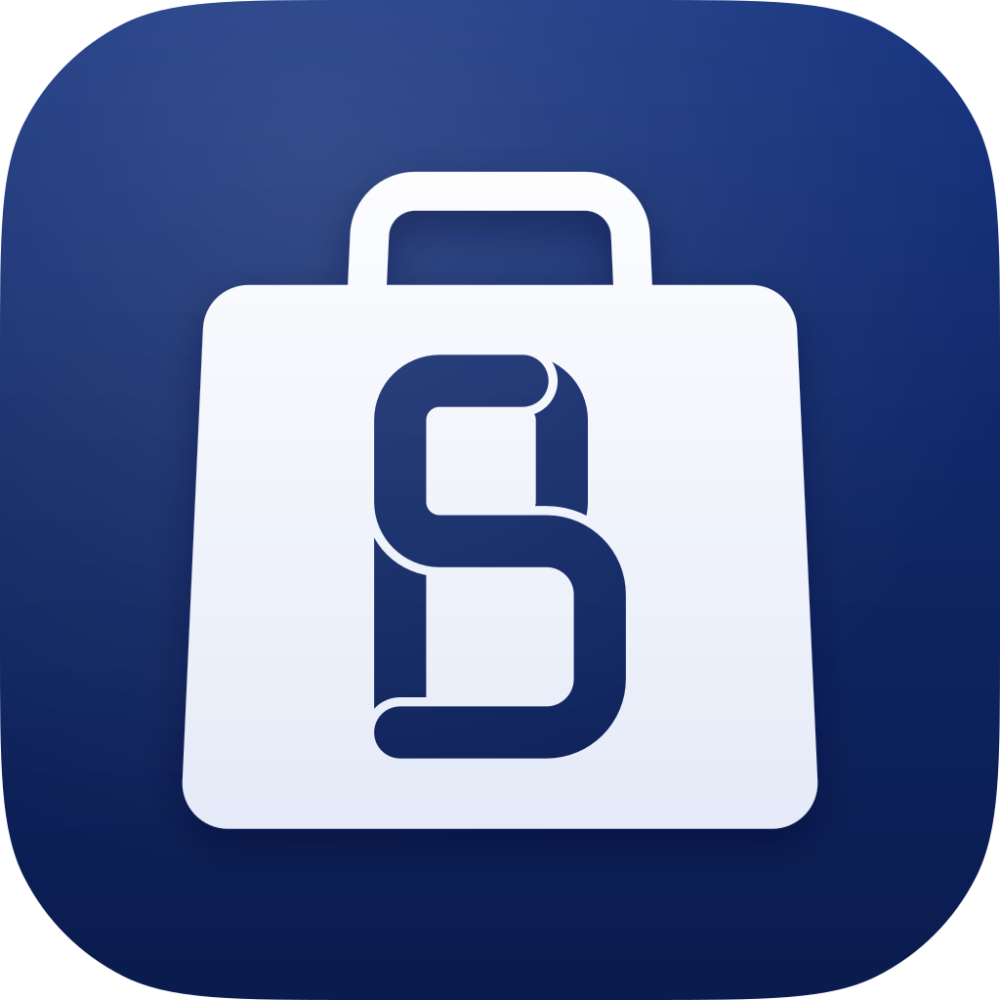

<p align="center"></p>

<h1 align="center">BariStore</h1>

An app store for iPhone and iPad that needs no computer. It runs in
[Open Minis](https://apps.apple.com/app/id6759188481), signs apps with your
own free Apple ID and installs them on the same device.

> **Status: 0.10 alpha.** Tested on Linux against independent implementations.
> On a device so far: LocalDevVPN check and pairing work (iOS 27). Apple ID
> sign-in, signing and installing are still being tested.

## What you need

| | |
|---|---|
| Device | iPhone or iPad on **iOS / iPadOS 27 or newer** |
| Apps | **Open Minis 1.16+** and **LocalDevVPN** (both free on the App Store) |
| Apple ID | a **free** one is enough |
| Settings | **Developer Mode** on, **Wi-Fi** on, LocalDevVPN connected |

## Install

In Open Minis's terminal:

```sh
wget -qO- https://raw.githubusercontent.com/barismd/BariStore/main/install.sh | sh
```

After that, `baristore` opens the store over the terminal. `baristore update`
installs the newest build; `baristore doctor` prints a report to paste when
something goes wrong (it contains no password, token or key).

## First run

The store walks you through it:

1. **LocalDevVPN and Developer Mode**: BariStore checks the loopback VPN answers.
2. **Pairing**: Minis opens a player that plays silence so iOS keeps it
   running in the background; swipe it down, it keeps playing in a small
   bubble. Open Settings › Privacy & Security › Developer Mode, tap **Pair with
   BariStore** and enter your passcode: the 6-digit code arrives then, as a
   notification, and you type it in Settings.
3. **Developer Mode** is read over the new connection; if it is off, BariStore
   can show the switch or turn it on (the iPhone restarts).
4. **Apple ID** sign-in, two-factor code included. BariStore never signs you out.

## Using it

- **Featured**: search, add AltSources, and BariStore's picks: AltStore Classic,
  SideStore, LiveContainer + SideStore and LiveContainer, stable and nightly,
  resolved live from each project's GitHub releases. When an app is offered by
  several sources you choose which one to install from.
- **My Apps**: what BariStore installed, days left, refresh, delete, put the
  pairing file into SideStore / LiveContainer / AltStore. SideStore, AltStore and
  LiveContainer + SideStore also get the signing certificate
  (`ALTCertificate.p12`), so they can refresh themselves without asking Apple
  for a new one.
- **Options**: Apple ID, pairing-file export, install defaults (Increased
  Memory Limit, remove extensions), sources, appearance, diagnostics, reset.

Opening the store needs no network. Installing and refreshing check LocalDevVPN,
the pairing and the Apple ID first, say what is missing, and let you retry.

Free Apple ID limits (Apple's): apps expire after **7 days** (refresh them),
**3** sideloaded apps at a time (BariStore itself does not count, it runs in
Minis), **10** new App IDs per 7 days (each app extension needs one; "Remove
extensions" saves them).

## Your Apple ID

- **The password never leaves the device.** Apple's sign-in is SRP: the password
  becomes a one-time proof on the iPhone. It is not stored.
- **The anisette server never sees your account.** It supplies Apple's
  device-identity headers from a random identifier, nothing else. Since
  October 2026 Apple refuses servers built on its Android library, so BariStore
  uses the macOS- and Windows-library ones, in siboot's order:
  `new.ani.sidestore.io`, `mac-ani.jkcoxson.com`, `ani.iloader.app`,
  `ani3.stikstore.app`, `ani.jkcoxson.com`, `ani2.stikstore.app`,
  `win.ani.sidestore.io`.
- The session token, the pairing record and the signing key stay in
  `~/.baristore` inside Minis (mode 600). **No BariStore server exists**: no
  accounts, no analytics.

## How it works

One static Rust binary (Alpine aarch64 in Minis's iSH). Our own code for: the
pairable host (SRP-6a, TLV8, OPACK, Ed25519, ChaCha20-Poly1305) advertised
through `minis-bonjour`; pair-verify, the TLS 1.2 PSK tunnel and a userspace
IPv6/TCP stack to the iPhone over LocalDevVPN; RemoteXPC/RSD; AFC,
installation_proxy, house_arrest, AMFI; anisette v3 and GrandSlam sign-in; the
developer portal; Mach-O code signing; the store and its page.

Build: `./scripts/build.sh` (Rust + `pip install ziglang`), tests: `cargo test`.

## Licence

MIT, see [LICENSE](LICENSE). Third-party notices: [THIRD_PARTY_NOTICES.md](THIRD_PARTY_NOTICES.md).
